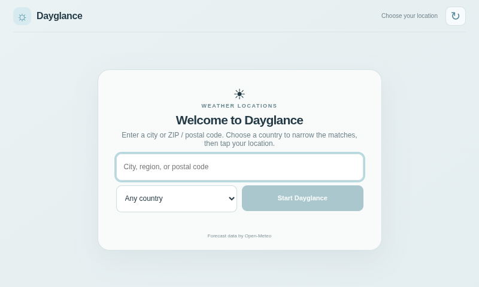
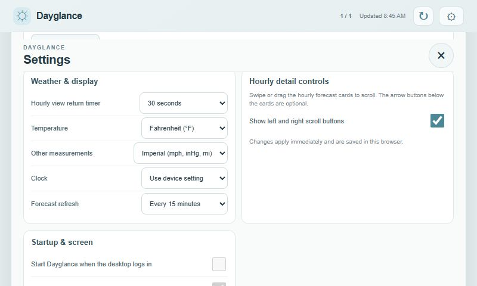

# Dayglance

Dayglance is a glanceable weather display for Raspberry Pi and other compact landscape screens. Its main view brings current conditions, a configurable temperature graph, and the next seven days together on one screen. Tap today or a forecast day for its 24-hour details, then swipe between saved places. Optional smooth city rotation lets it cycle on its own when showing more than one location.

It is designed for touch-first, keyboard-free use after setup: locations and display options can be managed on screen or copied in through `config.json`. Dayglance runs as a small local Python server with a browser interface; forecasts and location search are fetched from Open-Meteo. It does not require an account or an API key for personal, non-commercial use.

## What Dayglance is

Dayglance is a personal weather dashboard for a wall or desk display such as a Raspberry Pi touchscreen. The compact overview is meant to be read at a glance, while hourly details are available on demand and automatically return to the overview after an adjustable idle period. People can swipe between saved places manually or enable a smooth timed rotation. The display stays under the user's control: locations, units, graph range, rotation interval, and other preferences can be changed in Settings or distributed in a JSON configuration file.

The project is intentionally lightweight for Raspberry Pi hardware: a dependency-free Python standard-library server serves a static web app, and the browser requests weather data directly from Open-Meteo. The example installation uses a Raspberry Pi 3 B+ and an 800×480 landscape touchscreen. It also runs in a regular desktop browser.

Dayglance currently provides forecasts and archived past-days data through Open-Meteo. It does not currently connect to personal weather stations or provide a rain-radar map; both remain possible future integrations rather than existing features.

## Screenshots






## Features

- Guided first-run setup with city, region, and ZIP/postal-code search and live location suggestions.
- Forecast refresh becomes available once a location is configured; the first-run location screen has no refresh action.
- Current conditions, feels-like temperature, sunrise/sunset, and a configurable temperature graph: next 24 hours, 7-day forecast, up to 16 forecast days, or archived weather data for the past 30 days.
- Hourly detail cards for today or a selected forecast day. Swipe, drag, use the large arrow controls, or scroll the hourly strip.
- Multiple saved locations with touch-friendly horizontal navigation, plus an edit control beside the city name.
- Optional automatic sideways rotation through saved locations, with configurable 30-second, 1-minute, 5-minute, and 15-minute dwell times.
- A settings menu and copyable `config.json` for locations, units, clock format, refresh interval, graph period, the hourly-view return timer, and optional hourly navigation buttons.
- Settings scroll by swiping or dragging over the content; the compact title and close control stay visible while you browse options. The app also supports wheel/trackpad and keyboard scrolling without showing a scrollbar.
- Optional Raspberry Pi desktop auto-start and kiosk launch settings, configurable in `config.json` or on the Pi itself.
- Hourly view returns after 60 seconds without interaction by default. The timer pauses while you interact and starts over after you stop; choose a different interval in Settings or `config.json`.
- Inline SVG weather icons, a responsive 800×480 layout, and a cached app shell for offline startup.
- No account or API key is needed for personal, non-commercial use of the free Open-Meteo endpoint.

## Example hardware

Dayglance has been exercised on the DevPi touchscreen setup. This is a working example, not a minimum hardware requirement.

| Component | Example |
|---|---|
| Computer | Raspberry Pi 3 Model B+ |
| Operating system | Raspberry Pi OS 64-bit (Debian 13.7 Trixie, arm64) |
| Storage | 16 GB microSD card |
| Display | DSI touchscreen at 800×480. The [Hosyond 7-inch DSI touchscreen listing](https://www.amazon.com/dp/B0D3QB7X4Z?th=1) supplied for this setup advertises IPS, capacitive touch, and 800×480 resolution. This is a non-affiliate link. |
| App runtime | Python 3 standard-library web server and Chromium kiosk browser |
| Network | Internet access for location search and current forecast data from Open-Meteo |

The fleet inventory records the DevPi panel as 10.1 inches, while the linked product listing describes a 7-inch panel. The deployed resolution and DSI interface match; confirm the display's diagonal/model before using the listing as an exact replacement-parts reference.

## Quick start

Requirements: Python 3 and a modern browser. The included server uses only Python's standard library.

```sh
git clone https://github.com/mderdouri/Dayglance.git
cd Dayglance
python3 server.py
```

Open [http://localhost:8080](http://localhost:8080), search for your city or ZIP/postal code, and select a validated match. The browser remembers your locations on that device.

On a Raspberry Pi, use the same commands in a terminal. For a kiosk on the Pi itself, open `http://localhost:8080` in Chromium with kiosk mode after starting the server. See [INSTALLING.md](INSTALLING.md) for step-by-step installation and [CONFIGURATION.md](CONFIGURATION.md) for preconfigured locations.

To make the server reachable from another device on your local network, bind it to the Pi's LAN interfaces:

```sh
python3 server.py --host 0.0.0.0 --port 8080
```

Then open `http://<pi-address>:8080` from the other device. Use this only on a trusted network; the server is a simple local display server, not an internet-facing web server.

## Tests

Run the server configuration tests with `python3 -m unittest discover -s tests -v` and the startup launcher tests with `sh tests/test-launcher-config.sh` on Linux, Raspberry Pi OS, or WSL. The launcher test uses port 8080 and exits if that port is already in use.

## Data source and usage

Forecast and geocoding requests go directly from the browser to Open-Meteo. The interface credits Open-Meteo. Open-Meteo's free hosted API is for non-commercial use, is rate-limited, and has no uptime guarantee; review its current [pricing and usage terms](https://open-meteo.com/en/pricing) before using Dayglance commercially or at scale. The underlying weather datasets are provided under CC BY 4.0 and require attribution. Location search uses GeoNames data through Open-Meteo. See [third-party notices](THIRD_PARTY_NOTICES.md).

## Project status

Dayglance is an actively developed personal project. It has been exercised on a Raspberry Pi touchscreen, but browser, display, and screensaver behavior can vary by device. Contributions and issue reports are welcome. See [CONTRIBUTING.md](CONTRIBUTING.md), [GOVERNANCE.md](GOVERNANCE.md), and [CODING_STANDARDS.md](CODING_STANDARDS.md) for contribution, review, and coding guidance.

Touchscreen layout and interaction decisions are recorded in [DESIGN_NOTES.md](DESIGN_NOTES.md).

## License

Dayglance's original software is released under the [MIT License](LICENSE). That license does not change the separate terms for remote weather or geocoding services and their datasets.
