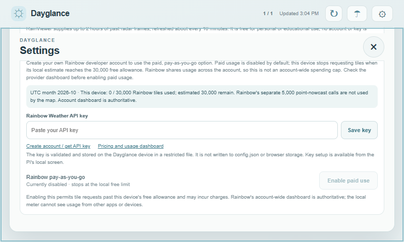

# Dayglance screenshots

Screenshots in this gallery use synthetic or unconfigured sample data. They show the interface without publishing a user's saved location, station identifier, provider credential, or private device details.

## Setup and dashboard interactions

## Forecast details

This 800×480 preview uses synthetic forecast data and an example location.

This 800×480 browser preview uses synthetic hourly data; swipe, drag, and scrolling remain available.

## Setup and settings

This isolated 800×480 preview uses synthetic alert data to demonstrate status layout; it is not a physical-device capture.

This isolated preview uses synthetic profile labels. Key fields are blank; no real credentials or device-specific information are shown.

## Rain radar

