# Dayglance screenshots

All project screenshots are kept in this folder so they are easy to find and do not clutter the repository root. The README embeds only the live dashboard and hourly detail views; this gallery keeps the rest of the product and device captures available.

## Live dashboard

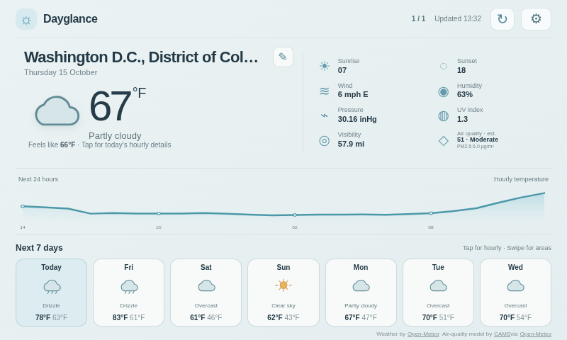

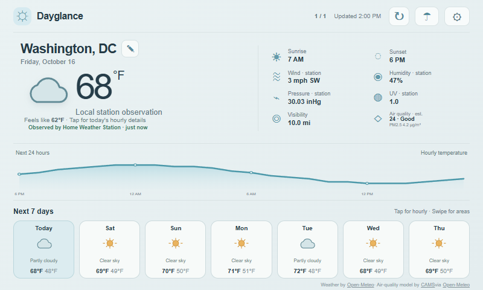

This 800×480 browser capture uses synthetic test forecast and station readings to verify the local-station UI; it is not a measurement from the physical station.

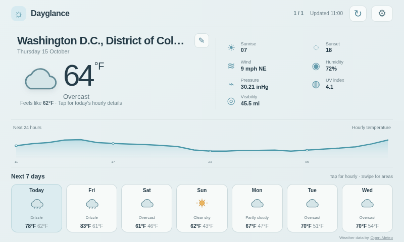

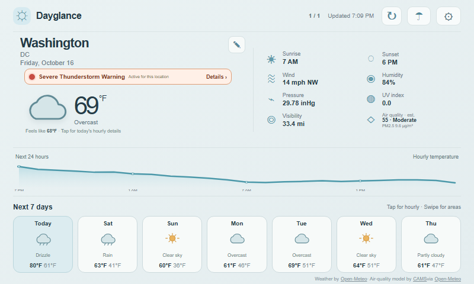

This isolated 800×480 preview uses a synthetic National Weather Service alert payload to demonstrate the banner and layout. The forecast values were fetched during preview and change over time; this is not a physical touchscreen capture or a live warning.

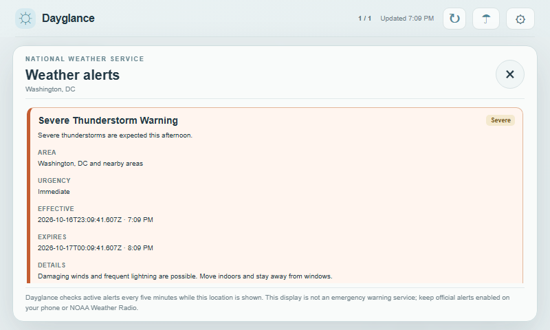

This isolated 800×480 preview uses synthetic alert details. The detail card is vertically swipeable when alert text extends beyond the screen.

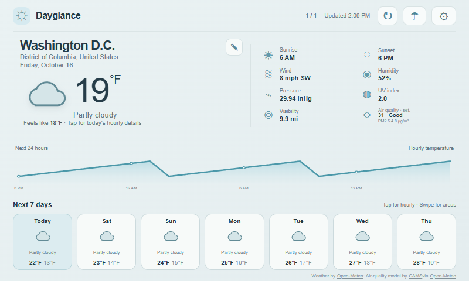

This interface preview uses simulated forecast values; it demonstrates the location heading layout, not live conditions.

## Forecast details

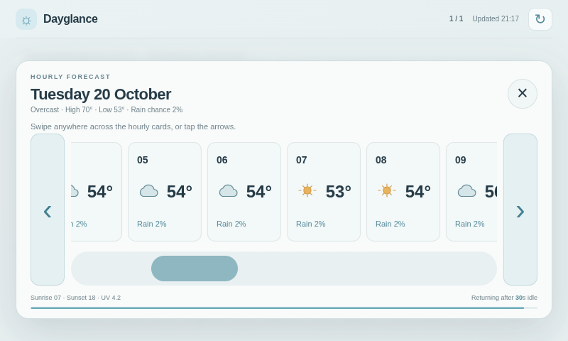

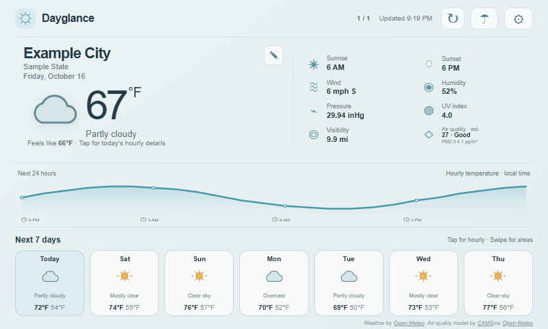

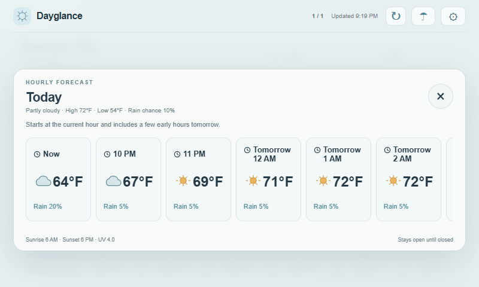

This 800×480 preview uses synthetic forecast data and an example location.

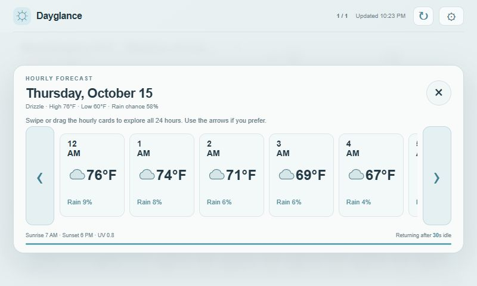

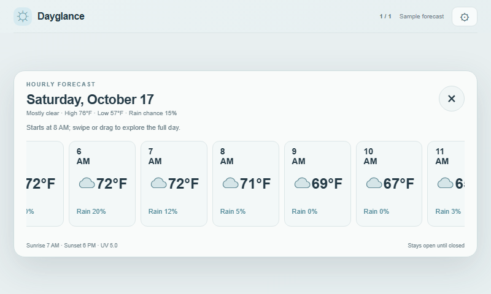

This 800×480 browser preview uses synthetic hourly data; it shows the default view without arrow bumpers. Swipe, drag, and scrolling remain available.

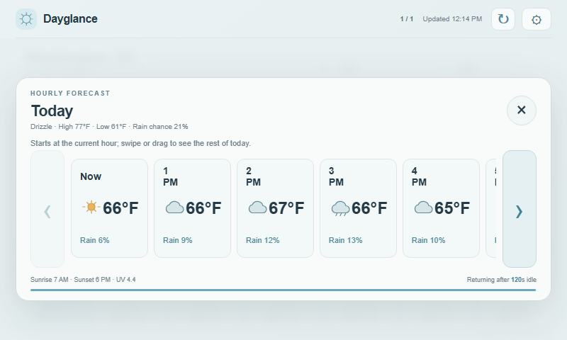

## Setup and settings

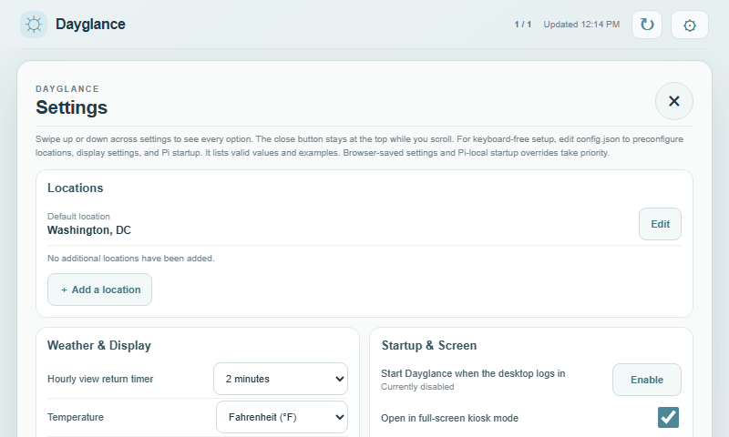

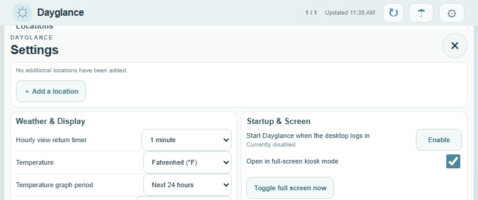

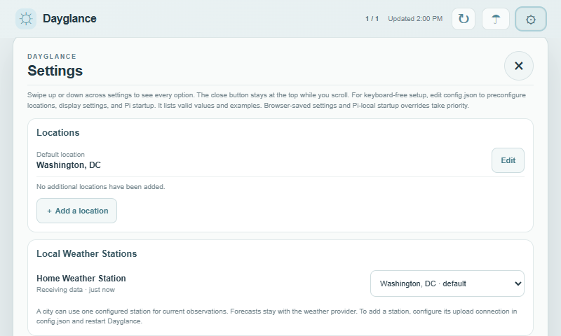

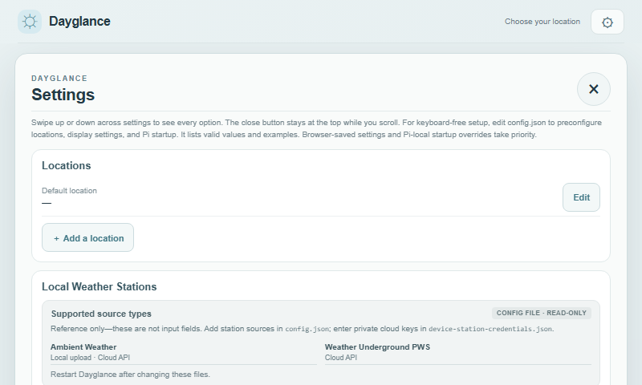

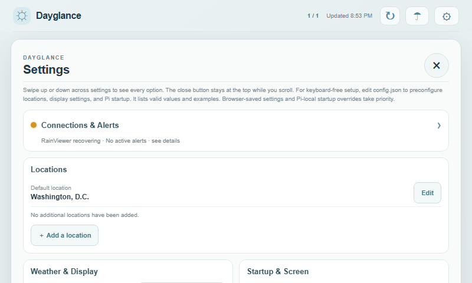

This isolated 800×480 browser capture uses a sample Washington, D.C. location. Connections & Alerts spans the first row, Locations remains full width beneath it, and the remaining settings are paired by category. At narrower widths, the same order stacks into one column. This is not a physical touchscreen capture.

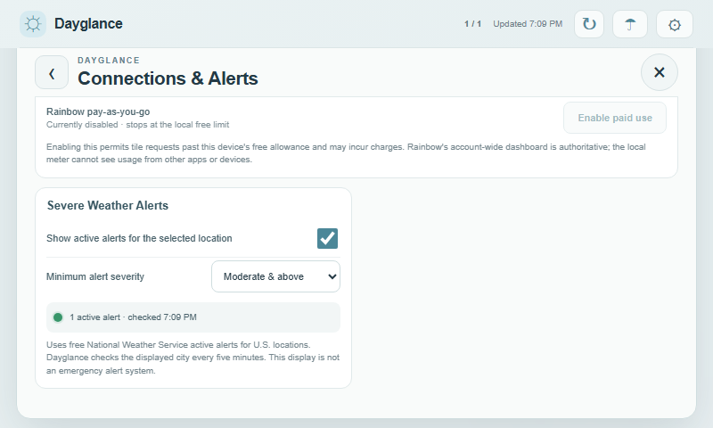

These isolated 800×480 captures use the current Settings structure. The status dot reflects the feed state during preview; synthetic alert data is used only to make the active-alert state visible.

This isolated 800×480 Chrome preview uses the current Settings markup and styles; it verifies that cloud/local connection options are discoverable, but is not a physical DevPi touchscreen capture.

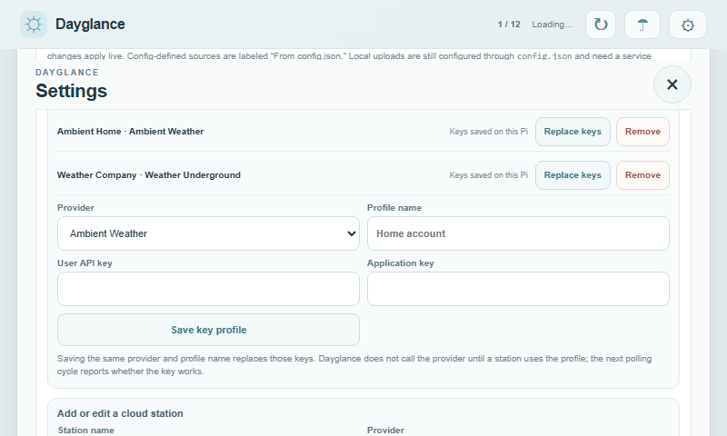

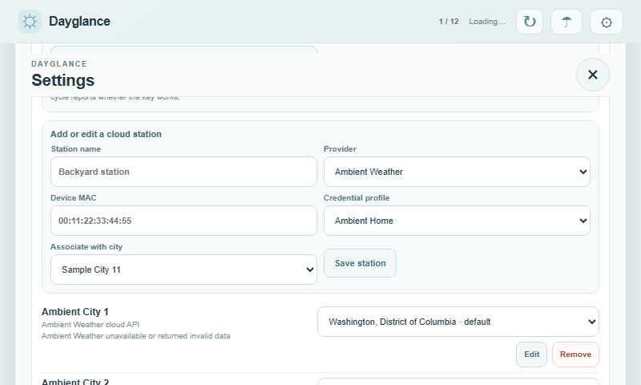

These isolated 800×480 Chrome previews use synthetic profile labels, station IDs, locations, and keys. They demonstrate the cloud-station manager; no real credentials or physical touchscreen are shown.

## Air-quality preview

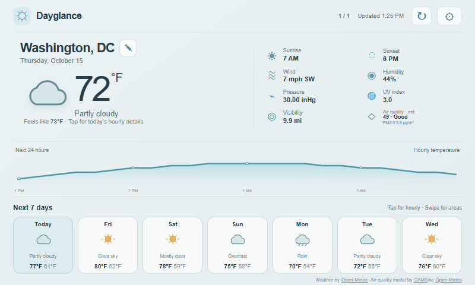

## Rain radar

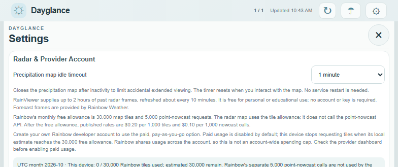

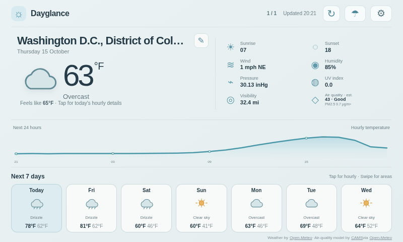
